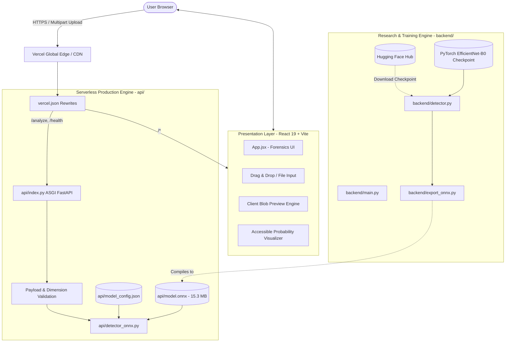
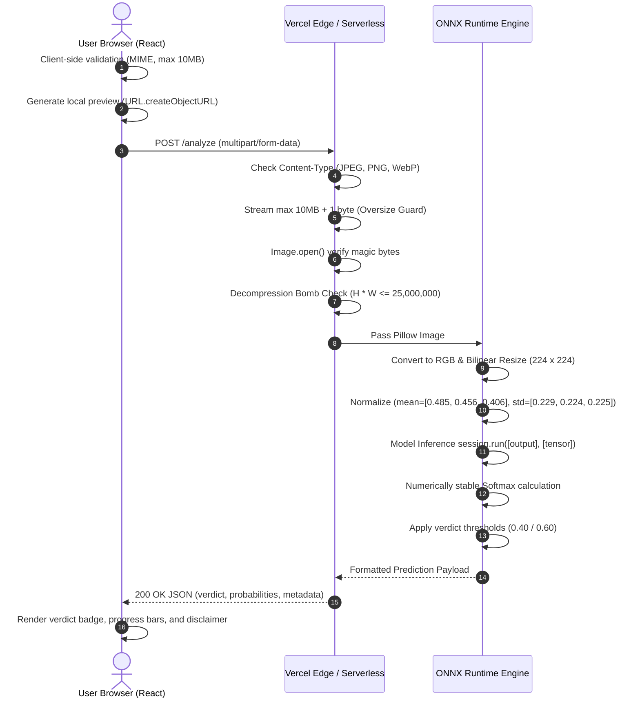
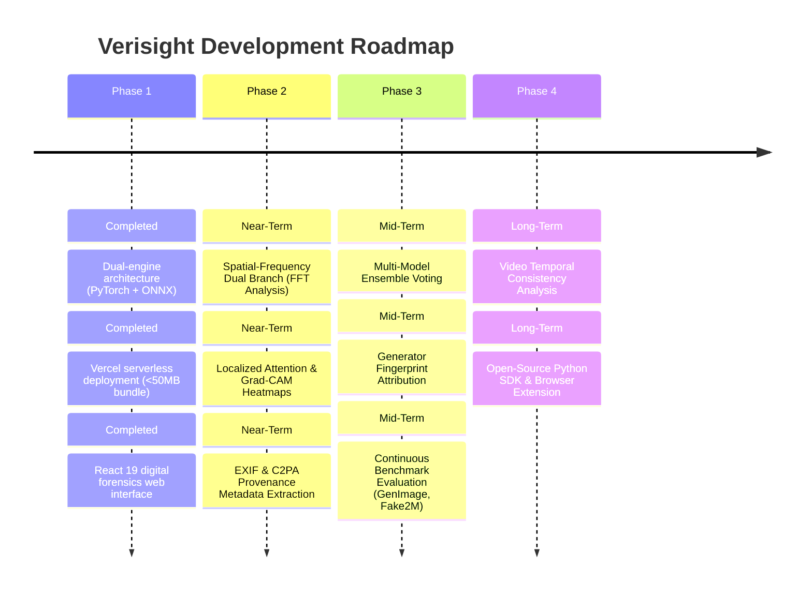

# Verisight: Deep-Learning Image Authenticity & Digital Forensics Platform
## Comprehensive Architectural & System Documentation

---

## 1. Executive Summary

**Verisight** (internally designated `imgai` / `real-or-ai`) is an open, production-grade digital image forensics platform engineered to estimate whether a digital image is authentic (a real-world photograph) or synthetically generated by Artificial Intelligence (AI). 

By leveraging an optimized deep-learning vision backbone ([EfficientNet-B0](https://arxiv.org/abs/1905.11946)) fine-tuned specifically on synthetic vs. authentic visual distributions, Verisight extracts high-level semantic and structural artifacts left behind by generative pipelines.

The platform is designed with a **dual-engine architecture**:
1. **A Serverless Cloud Engine** running on **FastAPI** and **ONNX Runtime**, specifically designed for sub-second cold starts, zero GPU dependencies, and ultra-lightweight serverless execution on **Vercel** (<50 MB deployment footprint).
2. **A Research & Local Training Engine** powered by **PyTorch**, **Torchvision**, and **Hugging Face Hub**, supporting local GPU acceleration, checkpoint evaluation, and model re-training.

Complementing the backend is a responsive, accessible **React 19** web application featuring a digital forensics visual language, immediate drag-and-drop feedback, confidence-calibrated probability distributions, and explicit scientific disclaimers.

---

## 2. Problem Area & Background

### 2.1 The Generative Explosion and Media Integrity
The democratization of modern generative image models—including Latent Diffusion Models (Stable Diffusion, SDXL, Flux), Autoregressive Generators, Variational Autoencoders (VAEs), and Generative Adversarial Networks (GANs like StyleGAN)—has fundamentally shifted the threshold of visual realism. Photorealistic synthetic imagery is now indistinguishable from optical camera captures to the unassisted human eye.

This paradigm shift creates systemic vulnerabilities across key sectors:
- **Information Integrity & Journalism**: Malicious actors create synthetic photo evidence of geopolitical events, conflicts, natural disasters, or public figures to manufacture disinformation.
- **Financial Fraud & KYC**: AI-generated identity documents, synthetic headshots, and spoofed verification assets compromise identity verification systems.
- **Legal & Judicial Forensics**: Admissibility of photographic evidence is compromised when visual media can be synthesized or manipulated with consumer hardware.
- **Cybersecurity & Social Engineering**: Spear-phishing and impersonation attacks rely heavily on synthesized avatars and staged visual narratives.

### 2.2 Technical Challenges in Synthetic Image Detection
Detecting generative media is notoriously difficult due to several core technical obstacles:
1. **Vanishing Artifacts**: Modern generative architectures (e.g., Flux, Midjourney v6) produce far fewer overt anatomical errors (e.g., deformed hands, impossible reflections) than earlier iterations.
2. **Social Media Transcoding & Compression**: When images are shared via platforms such as X (Twitter), WhatsApp, or Instagram, aggressive JPEG re-compression, chroma subsampling, and spatial downsampling strip away delicate pixel-level noise signatures and PRNU (Photo-Response Non-Uniformity) sensor patterns.
3. **Distribution Shift & Out-of-Distribution (OOD) Generative Families**: Detectors trained exclusively on one generator (e.g., StyleGAN or SD 1.5) often suffer catastrophic performance degradation when evaluating unseen generator families (e.g., DALL-E 3 or Flux).
4. **Cloud & Deployment Friction**: Traditional deep-learning inference stacks rely on monolithic PyTorch or TensorFlow runtimes, requiring >1 GB container layers, prolonged cold starts (10–30s), and expensive GPU hosting, making real-time, consumer-accessible web deployment cost-prohibitive.

---

## 3. The Verisight Solution

Verisight addresses these problems by providing an accessible, transparent, and resource-efficient verification pipeline:

```
+--------------------------------------------------------------------------------------------------+
|                                    VERISIGHT CORE VALUE PROPOSITION                              |
+------------------------------------+------------------------------------+------------------------+
| 1. High-Performance Vision Model   | 2. Serverless Edge Optimization    | 3. Responsible Science |
| Fine-tuned EfficientNet-B0         | ONNX Runtime graph execution       | Tri-state verdicts     |
| captures subtle synthesis signals  | with sub-50MB deployment bundle    | with calibrated scores |
| across structural & color spaces.  | running in milliseconds on Vercel. | and clear disclaimers. |
+------------------------------------+------------------------------------+------------------------+
```

### Key Solution Highlights:
- **Optimized Lightweight Inference**: By distilling the model into an **ONNX (Open Neural Network Exchange)** runtime graph, the model file is reduced to **15.3 MB**. Inference runs entirely on CPU within **~20–50 ms**, eliminating GPU requirements and cloud infrastructure costs.
- **Zero-Friction Serverless Hosting**: The complete serverless package (FastAPI, ONNX Runtime, NumPy, Pillow) packages under **50 MB**, running well inside Vercel’s 250 MB serverless ceiling with no cold-start timeouts.
- **Calibrated Three-Tier Classification**: Rather than forcing a binary classification, the system produces probability scores and categorizes predictions into:
  - **Likely AI-generated** ($P(\text{AI}) \ge 0.60$)
  - **Likely real** ($P(\text{AI}) \le 0.40$)
  - **Uncertain** ($0.40 < P(\text{AI}) < 0.60$)
- **Defensive Image Ingestion**: Built-in protection against decompression bombs (pixel bombs > 25M pixels), payload overloads (> 10 MB), and file type spoofing.

---

## 4. System Architecture

Verisight is built as a modular monorepo decoupled into presentation, serverless edge inference, and local research training layers.

### 4.1 High-Level Architecture Diagram



---

## 5. End-to-End Processing Pipeline

The following diagram illustrates the lifecycle of an image from user submission to verdict display:



---

## 6. Technical Specifications & Stack

### 6.1 Technology Matrix

| Layer | Component | Version / Technology | Purpose |
|---|---|---|---|
| **Frontend** | Framework | React 19.x | Modern UI state and concurrent rendering |
| | Build Tool | Vite 6.x | Fast HMR and optimized production bundling |
| | Styling | Pure CSS Tokens | Low-overhead forensics design language |
| | Icons | `lucide-react` | Clean, accessible forensic iconography |
| **Serverless Backend** | Web Framework | FastAPI / ASGI | Async request handling and OpenAPI spec |
| | Inference Engine | ONNX Runtime (`onnxruntime`) | Low-memory, SIMD-accelerated CPU inference |
| | Imaging | Pillow (PIL) 10.x | Secure image loading, decompression, and resizing |
| | Math | NumPy | Tensor restructuring and softmax arithmetic |
| **Research Engine** | Framework | PyTorch 2.x | High-performance GPU tensor operations |
| | Vision Library | Torchvision | EfficientNet model definitions & transforms |
| | Model Registry | Hugging Face Hub (`huggingface_hub`) | Automated checkpoint fetching |
| **Deployment** | Serverless Cloud | Vercel Serverless Functions | Automated git-triggered serverless deployment |

---

## 7. Model Details & Preprocessing

### 7.1 Architecture Backbone
The model is built on **EfficientNet-B0**, a convolutional architecture developed through Neural Architecture Search (NAS) that optimizes both accuracy and floating-point operations (FLOPs) using compound scaling across network depth, width, and image resolution.

- **Feature Extractor**: Inverted residual blocks with Squeeze-and-Excitation (SE) attention mechanisms.
- **Input Dimensions**: $(1, 3, 224, 224)$ — 3-channel RGB image resized via bilinear interpolation.
- **Classifier Head**:
  ```python
  Sequential(
      Dropout(p=0.4, inplace=False),
      Linear(in_features=1280, out_features=2, bias=True)
  )
  ```
- **Target Classes**:
  - Index `0`: `ai_generated`
  - Index `1`: `real`

### 7.2 Normalization Constants
The input image is transformed using standard ImageNet distribution parameters:
$$\mu = [0.485, 0.456, 0.406], \quad \sigma = [0.229, 0.224, 0.225]$$
The pixel normalization formula applied per channel $c \in \{R, G, B\}$:
$$X_{\text{norm}}(c) = \frac{\frac{X(c)}{255.0} - \mu(c)}{\sigma(c)}$$

### 7.3 Numerically Stable Softmax & Scoring
To prevent overflow/underflow during exponentiation in inference:
$$z_i^* = z_i - \max_{j}(z_j)$$
$$P(\text{Class}_i) = \frac{e^{z_i^*}}{\sum_{k} e^{z_k^*}}$$
$$P(\text{AI}) = P(\text{Class}_0), \quad P(\text{Real}) = 1.0 - P(\text{AI})$$

---

## 8. Directory & File Organization

```
imgai/ (Verisight Root)
├── api/                             # Serverless Cloud Execution (Vercel)
│   ├── index.py                     # Serverless ASGI FastAPI entry point & security filters
│   ├── detector_onnx.py             # Optimized ONNX Runtime inference engine
│   ├── model.onnx                   # Exported EfficientNet-B0 ONNX weights (15.3 MB)
│   ├── model_config.json            # Model metadata, class labels, and normalization constants
│   └── requirements.txt             # Lightweight dependencies (<50 MB deployment bundle)
│
├── frontend/                        # Client Web Application
│   ├── public/
│   │   └── favicon.svg              # Forensic themed vector icon
│   ├── src/
│   │   ├── App.jsx                  # Main interface, upload drag-and-drop, state engine
│   │   ├── App.css                  # Component-specific styles and micro-animations
│   │   ├── index.css                # Global CSS variables, typographic tokens, reset
│   │   └── main.jsx                 # React root mounter
│   ├── index.html                   # HTML5 shell with OpenGraph and SEO tags
│   ├── package.json                 # Frontend dependencies (React 19, Lucide)
│   └── vite.config.js               # Vite compilation configuration
│
├── backend/                         # Local Research & Training Subsystem
│   ├── main.py                      # Local FastAPI service with PyTorch runtime
│   ├── detector.py                  # PyTorch model loader & GPU inference module
│   ├── export_onnx.py               # Export script with numerical verification testing
│   ├── requirements.txt             # PyTorch, Torchvision, and research dependencies
│   └── .env.example                 # Example environment variables
│
├── artifacts/                       # Shared Model Artifacts
│   ├── model.onnx                   # Backup copy of optimized ONNX model
│   └── model_config.json            # Backup copy of normalization configuration
│
├── notebooks/                       # Research, exploration, and benchmark notebooks
├── experiments/                     # Experiment metrics, evaluation runs, test datasets
├── .gitignore                       # Multi-layer protection against leaks and oversized files
├── package.json                     # Monorepo root script orchestration
├── vercel.json                      # Vercel deployment routes and serverless rewrites
├── README.md                        # Quickstart documentation
└── PROJECT_DOCUMENTATION.md         # Full project architectural documentation (this document)
```

---

## 9. API Reference

### 9.1 Service Health Check
- **Endpoint**: `GET /health`
- **Description**: Verifies service availability and reports active execution engine.
- **Response `200 OK`**:
```json
{
  "status": "ok",
  "engine": "onnxruntime"
}
```

### 9.2 Image Authenticity Analysis
- **Endpoint**: `POST /analyze`
- **Content-Type**: `multipart/form-data`
- **Request Parameters**:
  - `file`: Binary image file (MIME types: `image/jpeg`, `image/png`, `image/webp`). Max size: `10 MB`.

- **Response `200 OK`**:
```json
{
  "verdict": "Likely AI-generated",
  "ai_probability": 0.8842,
  "real_probability": 0.1158,
  "model": "bsgcasa/ai-vs-real-image-detector",
  "device": "cpu (onnx)",
  "disclaimer": "This is a model prediction, not proof of an image's origin."
}
```

- **Error Responses**:
  | Status Code | Reason | Example Response Body |
  |---|---|---|
  | `400 Bad Request` | Corrupted or non-image file | `{"detail": "The uploaded file is not a valid image."}` |
  | `413 Payload Too Large` | Exceeds 10MB or 25M pixels | `{"detail": "Image dimensions are too large."}` |
  | `415 Unsupported Media Type` | Non-supported format (e.g., GIF, BMP) | `{"detail": "Upload a JPG, PNG, or WebP image."}` |
  | `503 Service Unavailable` | Model execution error | `{"detail": "The detector could not run: ..."}` |

---

## 10. Security & Defensive Engineering

The application incorporates several layers of defensive engineering:

1. **Decompression Bomb Protection (Pixel Bomb Guard)**:
   Malicious actors can craft tiny (e.g., 200 KB) compressed images that decompress into tens of gigabytes of raw pixel bitmaps in memory, crashing server processes. Verisight inspects `image.width * image.height` immediately upon header decoding and rejects any image exceeding **25,000,000 pixels** (equivalent to ~25 Megapixels) with HTTP 413.

2. **Stream Truncation & Memory Exhaustion Prevention**:
   Instead of buffering arbitrary request streams into RAM via `await file.read()`, the API reads at most `MAX_FILE_SIZE + 1` bytes ($10 \text{ MB} + 1$). If the buffer exceeds 10 MB, reading aborts immediately, throwing HTTP 413 without loading the rest of the file into memory.

3. **Magic Byte Format Verification**:
   Checking client-supplied `Content-Type` headers is insufficient because headers can be easily spoofed. The backend passes bytes through Pillow's image parser to verify true binary magic headers before attempting any processing.

4. **Client-Side Blob Memory Hygiene**:
   In the React frontend, object URLs created via `URL.createObjectURL(file)` retain memory references until explicitly freed. Verisight implements cleanup routines within `useEffect` hooks and file-reset handlers using `URL.revokeObjectURL(preview)` to prevent client-side browser leaks during repeated image uploads.

5. **Restricted Serverless Execution Threads**:
   In `api/detector_onnx.py`, ONNX Runtime session threads are explicitly locked to:
   ```python
   sess_options.intra_op_num_threads = 1
   sess_options.inter_op_num_threads = 1
   ```
   This prevents CPU core thrashing inside serverless virtual environments, ensuring predictable performance and memory efficiency.

---

## 11. Known Limitations & Forensic Disclaimers

### 11.1 Scientific Caveats
No single computer vision model provides definitive proof of whether an image is synthetic or authentic. Deep learning models evaluate statistical correlations, and the following factors can affect model accuracy:
- **Strong JPEG Compression**: Re-compression artifacts from messaging apps (e.g., WhatsApp, Telegram) can introduce high-frequency noise that confuses convolutional filters.
- **Downsampling / Low Resolution**: Downsampling an image to 224×224 removes microscopic pixel correlations that might otherwise reveal generative patterns.
- **Hybrid Editing & Inpainting**: If an authentic photograph has a minor section modified with generative fill or inpainting, global image classification backbones may miss localized manipulations.
- **Emerging Generators (Out-of-Distribution)**: New generative architectures that introduce novel sampling techniques (e.g., rectified flow matching in Flux) can exhibit noise signatures distinct from older models.

### 11.2 Transparency by Design
Verisight reflects these limitations directly in the UI:
- Clear scientific disclaimers accompany every analysis result.
- Probabilities are displayed alongside verdicts so users can gauge model confidence.
- Ambiguous predictions ($0.40 < P(\text{AI}) < 0.60$) are clearly labeled as **"Uncertain"** rather than forced into a binary classification.

---

## 12. Future Scope & Roadmap



### 12.1 Phase 2: Near-Term Enhancements
1. **Spatial-Frequency Fusion (Radial 2D-FFT)**:
   Generative models often leave distinctive periodic grid patterns in the frequency domain. Incorporating a dual-stream architecture combining spatial RGB features with 2D Fast Fourier Transform (FFT) magnitude spectra will significantly increase robustness against compression.
2. **Explainable AI (XAI) & Grad-CAM Heatmaps**:
   Providing visual heatmaps highlighting which spatial regions (e.g., eyes, background textures, skin transitions) triggered the AI prediction, turning the black-box classifier into an interpretable forensic tool.
3. **EXIF & C2PA Metadata Parser**:
   Extracting cryptographic provenance metadata complying with the Coalition for Content Provenance and Authenticity (C2PA) standard, as well as camera EXIF tags, software signatures, and ICC color profiles.

### 12.2 Phase 3: Mid-Term Milestones
1. **Multi-Model Ensemble Pipeline**:
   Integrating an ensemble combining EfficientNet-B0 with vision transformers (e.g., Swin Transformer, ViT) and specialized forensic CNNs (e.g., MesoNet) for multi-angle evaluation.
2. **Generator Attribution & Fingerprinting**:
   Extending classification beyond binary detection to predict the specific generative source (e.g., Midjourney v5/v6, Stable Diffusion 1.5/SDXL, DALL-E 3, Flux).
3. **Continuous Automated Benchmark Pipeline**:
   Setting up automated CI/CD benchmark suites against public datasets (GenImage, SynthWild, DeepfakeBench) to systematically monitor precision and recall across model updates.

### 12.3 Phase 4: Long-Term Horizon
1. **Video Temporal Consistency Forensics**:
   Extending analysis to video files by sampling keyframes, analyzing inter-frame optical flow, and identifying temporal jitter artifacts common in AI-generated video models (e.g., Sora, Runway Gen-2, Kling).
2. **Client-Side WebAssembly (WASM) Inference**:
   Compiling the ONNX model to execute directly within the user's browser using WebAssembly / WebGPU, enabling 100% private, on-device analysis with zero server data transfer.
3. **Browser Extension & Developer API**:
   Releasing a cross-browser extension allowing users to right-click any image on the web for instant authenticity analysis, supported by authenticated developer API access.

---

## 13. License & Attribution

- **Project Lead**: Verisight Research Team
- **Baseline Model Checkpoint**: [`bsgcasa/ai-vs-real-image-detector`](https://huggingface.co/bsgcasa/ai-vs-real-image-detector)
- **License**: MIT License — open for academic research and educational experimentation.
